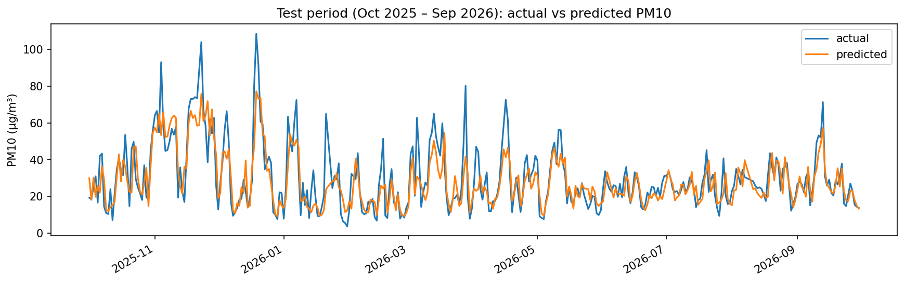
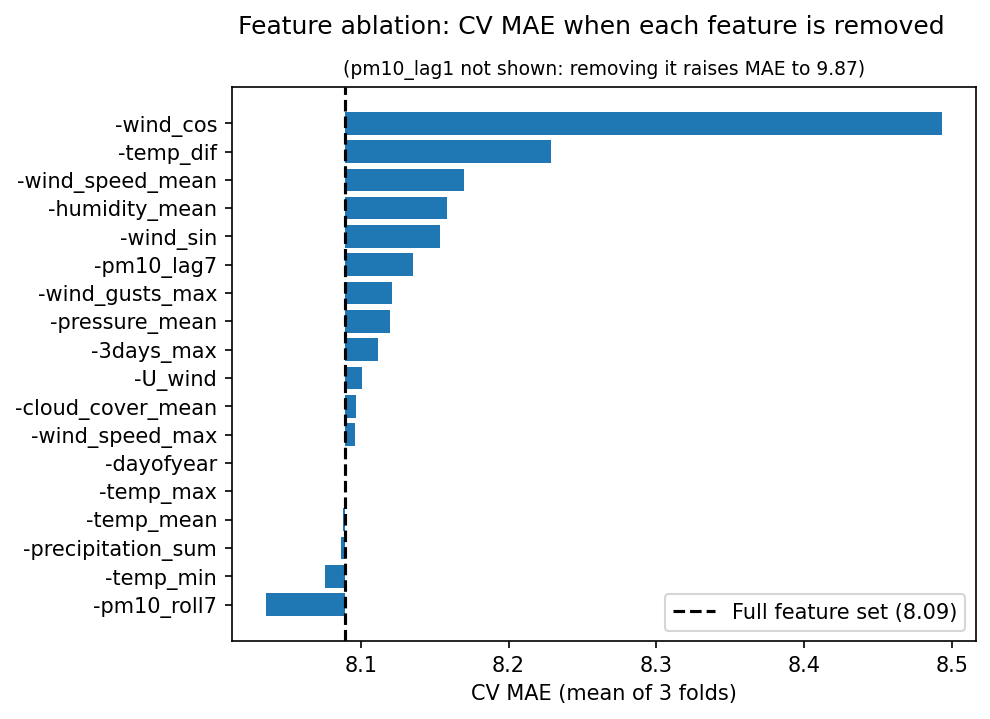
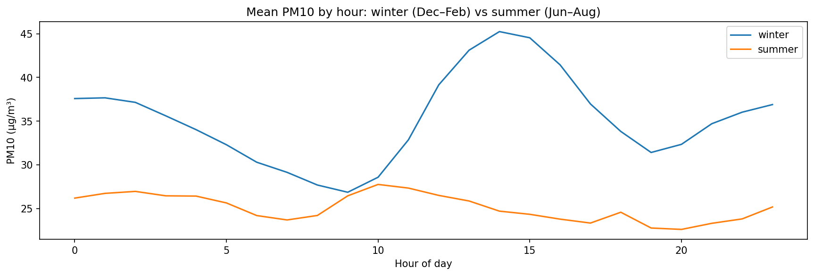

# Ankara PM10 Forecast

[](https://ankara-pm10-forecast.streamlit.app/)

I wanted to see how well I could predict tomorrow's air pollution in Ankara. This project forecasts the next day's mean PM10 at the Bahçelievler monitoring station using hourly air quality data, hourly weather data and a LightGBM model.

On a held-out year the model's error is 28% lower than the simplest guess, "tomorrow will be like today".

## Results

Test year: October 2025 to September 2026. The model never saw this year during training or tuning, and I evaluated it only once at the end.

| | MAE (µg/m³) | RMSE (µg/m³) | R² |
|---|---|---|---|
| Baseline (yesterday's value) | 10.12 | 14.03 | 0.39 |
| **Model** | **7.31** | **10.10** | **0.68** |

R² is computed on the days where yesterday's value exists (4 days missing).

In cross-validation (three validation years, 2022-23, 2023-24, 2024-25) the mean MAE was 8.09 for the model and 9.55 for the baseline, and the model was better in every year.



The model follows the general level and day-to-day changes well. Where it struggles is the peaks: on the highest-pollution days it predicts too low.

## Data

- **Air quality:** hourly PM10, PM2.5, NO2, SO2 and CO for the Bahçelievler station from the Ministry of Environment's national monitoring network, September 2020 to October 2026.
- **Weather:** hourly temperature, humidity, precipitation, pressure, wind speed, wind direction, gusts and cloud cover from [Open-Meteo](https://open-meteo.com/) for the station's location.

After joining the two by hour I had 53,188 hourly rows, which I turned into 2,217 daily rows. If a day had fewer than 18 hourly PM10 measurements I treated its daily mean as missing (133 days, mostly gaps in May 2022 and August 2025).

One honest caveat: the weather data is reanalysis, meaning it describes what actually happened. A real forecast would have to use forecast weather for tomorrow, which is less accurate, so real-world error would be somewhat higher than what I report here.

## Approach

### Features

Each row is the day being predicted. Weather features are that day's values (standing in for a weather forecast). Anything that comes from pollution measurements is shifted by at least one day, so the model never sees the day it is predicting.

The final model uses 19 features:

- **Past PM10:** yesterday's value, the value a week ago, the 7-day mean and the 3-day max (all from days before the target day)
- **Weather:** mean, min and max temperature, daily temperature range, humidity, precipitation, pressure, mean and max wind speed, gusts, cloud cover
- **Wind direction:** encoded as sin and cos of the hourly direction, averaged per day, plus the east-west wind component
- **Season:** day of the year

### Model and validation

- LightGBM regressor trained on `log1p(PM10)`, because the target is right-skewed.
- Time-based cross-validation with three expanding folds. Each fold trains on all earlier data and validates on one full year (October to September), so every fold covers all seasons.
- I only kept a change (a new feature, a removed feature or new hyperparameters) if it improved **all three** folds, not just the average. Small average improvements were often just noise.
- Hyperparameters were tuned with Optuna. The final settings are `learning_rate=0.0118`, `n_estimators=456`, `num_leaves=21`, `min_child_samples=108`. A later Optuna run found settings with a better average, but they were worse on one fold, so I kept the original ones.

### Feature selection

I started from 16 base features. Removing any of them one at a time made at least one fold worse, so none were dropped.

Then I tried 15 candidate features with forward selection: each round I added every remaining candidate on its own, and kept the best one that improved all three folds. Three made it in, in this order: the daily temperature range, the 3-day PM10 max and the east-west wind component. After that nothing passed.

Things I tried that did not help: NO2 and SO2 from the previous day, the PM2.5/PM10 ratio, a heating season flag, day of the week, pressure change from the previous day, the number of almost-calm hours, night-time wind speed, the north-south wind component, PM10 from two days ago, its day-to-day change and the 3-day standard deviation.



This chart shows how much the cross-validation error goes up when each feature is removed from the final model. Yesterday's PM10 is by far the most important (removing it raises the error to 9.87, it is left out so the chart stays readable). After that come wind direction, the daily temperature range, wind speed and humidity.

## What I learned from the errors

- **Peaks are underestimated.** On all 15 of the worst days in the test year, the model predicted too low.
- **Sudden jumps can't be seen coming.** On some bad days yesterday was clean and the weather looked ordinary, so nothing in the inputs hinted at what was coming. Dust transport or a sudden inversion would explain these, but neither is in the data.
- **The model bets on things calming down.** When pollution was already high, the model usually predicted a drop. That is often right, but it fails when an episode lasts several days.
- **Winter is harder.** Even after dividing the error by each month's average PM10, winter months had roughly 1.5 to 2 times the relative error of summer months.



## Mistakes I made along the way

Two bugs changed my results and are worth mentioning:

- At one point I created the "previous day" NO2 feature by shifting the **hourly** data by one row before averaging. That shifted it by one hour, not one day, so the feature leaked the same day's NO2 and made results look much better than they were.
- I first averaged the wind direction angles per day and only then took sin and cos. Averaging angles directly is wrong (the mean of 359° and 1° comes out as 180°). Fixing this changed which features got selected, so I re-ran the whole feature selection afterwards.

## Future work

- Add boundary layer height and dust forecasts (both available from Open-Meteo). These target exactly the days the model misses.
- Re-test removing the 7-day PM10 mean. In the final ablation, removing it slightly lowered the average error, but I did not check it with the all-three-folds rule.
- Use forecast weather instead of reanalysis to get a realistic estimate of real-world error.
- Evaluate on data after October 2026, which no decision in this project has touched.

## Repository structure

```
├── app.py                  Streamlit app
├── requirements.txt
├── data/
│   └── data_stats.csv      daily feature table (output of notebook 03)
├── models/
│   ├── pm10_lgbm.joblib        final model, trained on all data
│   └── pm10_lgbm_eval.joblib   model trained until Sep 2025, used for the test results
├── figures/
└── notebooks/
    ├── 01_data_cleaning.ipynb
    ├── 02_eda.ipynb
    ├── 03_feature_engineering.ipynb
    └── 04_modeling.ipynb
```

## How to run

The app only needs the files in this repo. Python 3.12 is recommended.

```
pip install -r requirements.txt
streamlit run app.py
```

The notebooks were written in Google Colab and read files from a Google Drive folder set in the `BASE` variable at the top of each notebook. The raw files are not in this repo: the hourly air quality data can be downloaded from the Ministry of Environment's air quality monitoring website (Bahçelievler station), and the weather data from Open-Meteo's historical weather API. Run the notebooks in order, 01 to 04.
